<picture>
  <source media="(max-width: 600px) and (prefers-reduced-motion: no-preference)" srcset="./assets/profile-hero-mobile.gif" />
  <source media="(prefers-reduced-motion: no-preference)" srcset="./assets/profile-hero.gif" />
  <source media="(max-width: 600px)" srcset="./assets/profile-hero-mobile-static.png" />
  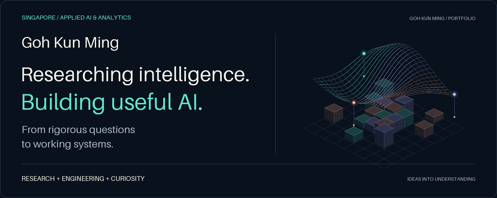
</picture>

  <a href="https://gohkunming.dev/"><b>Explore my website</b></a>
  &nbsp;·&nbsp;
  <a href="https://gohkunming.dev/documents/resume/goh-kun-ming-resume.pdf"><b>Résumé (PDF)</b></a>
  &nbsp;·&nbsp;
  <a href="https://www.linkedin.com/in/gohkunming/"><b>LinkedIn</b></a>
  &nbsp;·&nbsp;
  <a href="mailto:kunmingaden@gmail.com"><b>Email me</b></a>

# Researching intelligence. Building useful AI.

I'm **Goh Kun Ming**, a **Research Engineer intern at NCS · Pragnition Labs** and a **Year 3 Applied AI & Analytics student at Singapore Polytechnic**, based in Singapore.

I work across **machine learning, computer vision, retrieval-augmented AI, and data products**. I enjoy taking a research question through the whole build: preparing data, comparing models, evaluating limitations, and connecting the result to an application someone can use. My longer-term direction is **AI research and academia**, including teaching and mentoring.

**Explore my work for research engineering, applied AI/ML, and data-product opportunities.**

  <a href="#selected-work">Selected work</a> &nbsp;/&nbsp;
  <a href="#more-projects">More projects</a> &nbsp;/&nbsp;
  <a href="#experience">Experience</a> &nbsp;/&nbsp;
  <a href="#technical-toolkit">Technical toolkit</a> &nbsp;/&nbsp;
  <a href="#how-i-build">How I build</a> &nbsp;/&nbsp;
  <a href="#beyond-the-projects">Beyond the projects</a> &nbsp;/&nbsp;
  <a href="#lets-connect">Contact</a>

## Where I can contribute

| Focus | What I work on | Evidence to explore |
| :--- | :--- | :--- |
| **Research & evaluation** | Hypothesis-driven experiments, classical baselines, generative modelling, and bounded quantum-ML comparisons | [Hybrid generative models](https://github.com/fishman7337/hybrid-quantum-classical-gan-research) |
| **Applied AI systems** | Vision pipelines, model serving, APIs, and user-facing applications | [EstateScope AI](https://github.com/fishman7337/sp-daaa-doaa-ca1-housing-price-ml-application) · [VeggieAI](https://github.com/fishman7337/sp-daaa-doaa-ca2-vegetable-classification-application) |
| **Data & decisions** | Data validation, exploratory analysis, statistical reasoning, and clear visual explanations | [HDB resale analytics](https://github.com/fishman7337/sp-daaa-davi-ca1-hdb-price-dashboard) |

## Selected work

Five projects spanning generative research, AI applications, housing analytics, property-price prediction, and time-series forecasting. Explore the linked repositories for methods and results.

### 01 · Hybrid generative models

<a href="https://github.com/fishman7337/hybrid-quantum-classical-gan-research">
  <picture>
    <source media="(max-width: 600px) and (prefers-reduced-motion: no-preference)" srcset="./assets/portfolio-quantum-mobile.gif" />
    <source media="(prefers-reduced-motion: no-preference)" srcset="./assets/portfolio-quantum.gif" />
    <source media="(max-width: 600px)" srcset="./assets/portfolio-quantum-mobile-static.png" />
    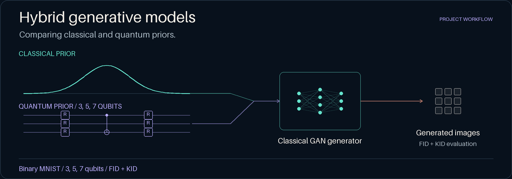
  </picture>
</a>

**Research question:** how do classical and circuit-based latent priors compare in a generative model?

Compared a classical GAN with **3-, 5-, and 7-qubit hybrid variants on binary MNIST**, with shared configuration and FID/KID evaluation utilities. The repository documents the comparison, reproducibility steps, and limitations.

`Python` · `TensorFlow` · `Qiskit` · `Optuna`

**[Explore the experiments →](https://github.com/fishman7337/hybrid-quantum-classical-gan-research)**

### 02 · EstateScope AI · Housing-price prediction

<a href="https://github.com/fishman7337/sp-daaa-doaa-ca1-housing-price-ml-application">
  <picture>
    <source media="(max-width: 600px) and (prefers-reduced-motion: no-preference)" srcset="./assets/portfolio-housing-mobile.gif" />
    <source media="(prefers-reduced-motion: no-preference)" srcset="./assets/portfolio-housing.gif" />
    <source media="(max-width: 600px)" srcset="./assets/portfolio-housing-mobile-static.png" />
    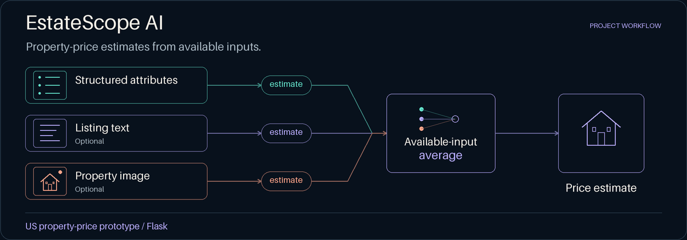
  </picture>
</a>

**Modelling focus:** estimate property prices from complementary input types.

Built a Flask prototype for US property-price estimation using structured attributes and optional listing descriptions and images. The application exposes per-modality estimates, combines available inputs, and supports authenticated prediction history and housing analytics. The repository documents held-out evaluation of the NLP component.

`Python` · `Flask` · `scikit-learn` · `TensorFlow` · `SQLite` · `Docker`

**[Explore the prediction application →](https://github.com/fishman7337/sp-daaa-doaa-ca1-housing-price-ml-application)**

### 03 · VeggieAI

<a href="https://github.com/fishman7337/sp-daaa-doaa-ca2-vegetable-classification-application">
  <picture>
    <source media="(max-width: 600px) and (prefers-reduced-motion: no-preference)" srcset="./assets/portfolio-product-mobile.gif" />
    <source media="(prefers-reduced-motion: no-preference)" srcset="./assets/portfolio-product.gif" />
    <source media="(max-width: 600px)" srcset="./assets/portfolio-product-mobile-static.png" />
    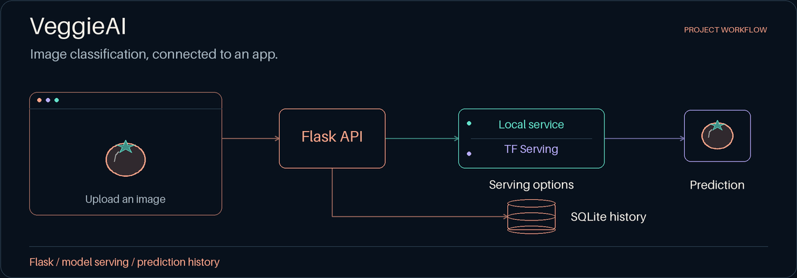
  </picture>
</a>

**Product focus:** connect image classification to a usable, testable application.

Built a Flask application with separate model serving, authentication, prediction history, a model registry, and Docker tooling. CI includes backend and model-service tests, registry validation, and local stack smoke checks.

`Flask` · `TensorFlow Serving` · `SQLite` · `Docker` · `GitHub Actions`

**[Explore the application →](https://github.com/fishman7337/sp-daaa-doaa-ca2-vegetable-classification-application)**

### 04 · HDB resale analytics

<a href="https://github.com/fishman7337/sp-daaa-davi-ca1-hdb-price-dashboard">
  <picture>
    <source media="(max-width: 600px) and (prefers-reduced-motion: no-preference)" srcset="./assets/portfolio-data-mobile.gif" />
    <source media="(prefers-reduced-motion: no-preference)" srcset="./assets/portfolio-data.gif" />
    <source media="(max-width: 600px)" srcset="./assets/portfolio-data-mobile-static.png" />
    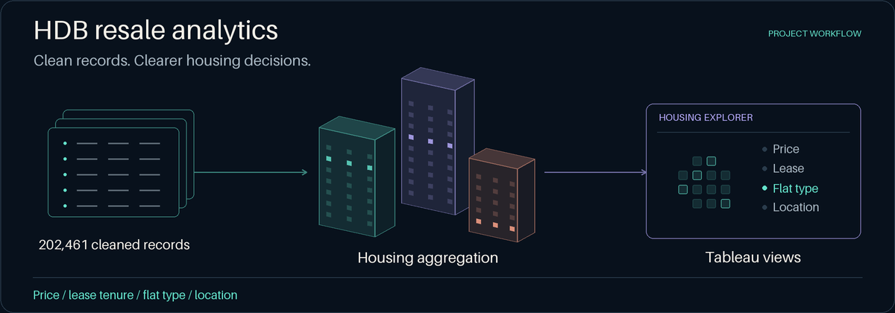
  </picture>
</a>

**Decision focus:** make Singapore housing data easier to explore and explain.

Prepared a cleaned dataset of **202,461 resale records** and Tableau views covering prices, lease tenure, flat types, and location. The repository preserves cleaning, geospatial enrichment, and validation steps so the analysis can be inspected and reproduced.

`Python` · `pandas` · `Tableau` · `Geospatial analysis`

**[Explore the analysis →](https://github.com/fishman7337/sp-daaa-davi-ca1-hdb-price-dashboard)**

### 05 · Energy consumption forecasting

<a href="https://github.com/fishman7337/sp-daaa-aiml-ca2-energy-consumption-forecast">
  <picture>
    <source media="(max-width: 600px) and (prefers-reduced-motion: no-preference)" srcset="./assets/portfolio-forecast-mobile.gif" />
    <source media="(prefers-reduced-motion: no-preference)" srcset="./assets/portfolio-forecast.gif" />
    <source media="(max-width: 600px)" srcset="./assets/portfolio-forecast-mobile-static.png" />
    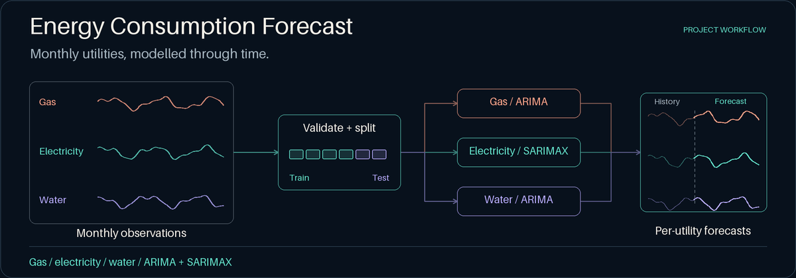
  </picture>
</a>

**Forecasting focus:** turn historical consumption into a reproducible modelling workflow.

Developed a time-series workflow for monthly gas, electricity, and water consumption, combining data validation, outlier handling, ARIMA/SARIMAX modelling, residual analysis, and a configured **60-month forecast horizon**. Each target is modelled separately, with evaluation and limitations documented alongside the code.

`Python` · `pandas` · `statsmodels` · `scikit-learn` · `Time-series analysis`

**[Explore the forecasting workflow →](https://github.com/fishman7337/sp-daaa-aiml-ca2-energy-consumption-forecast)**

## More projects

More of my work across decision support, language algorithms, data structures, full-stack development, and reinforcement learning.

### 06 · Student Performance Intelligence

<a href="https://github.com/fishman7337/sp-daaa-davi-ca2-student-performance-dashboard">
  <picture>
    <source media="(max-width: 600px) and (prefers-reduced-motion: no-preference)" srcset="./assets/portfolio-student-mobile.gif" />
    <source media="(prefers-reduced-motion: no-preference)" srcset="./assets/portfolio-student.gif" />
    <source media="(max-width: 600px)" srcset="./assets/portfolio-student-mobile-static.png" />
    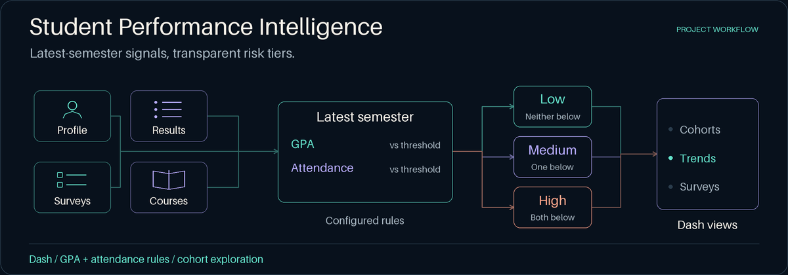
  </picture>
</a>

Built a Dash dashboard for GPA, attendance, cohort trends, and survey analysis. Configurable rules mark a tier as high when both GPA and attendance fall below their thresholds, medium when one does, and low when neither does—making the decision logic easy to inspect.

`Python` · `Dash` · `Plotly` · `pandas`

**[Explore the dashboard →](https://github.com/fishman7337/sp-daaa-davi-ca2-student-performance-dashboard)**

### 07 · HaikuForge AI

<a href="https://github.com/fishman7337/sp-daaa-dsaa-ca1-haiku-generator">
  <picture>
    <source media="(max-width: 600px) and (prefers-reduced-motion: no-preference)" srcset="./assets/portfolio-haiku-mobile.gif" />
    <source media="(prefers-reduced-motion: no-preference)" srcset="./assets/portfolio-haiku.gif" />
    <source media="(max-width: 600px)" srcset="./assets/portfolio-haiku-mobile-static.png" />
    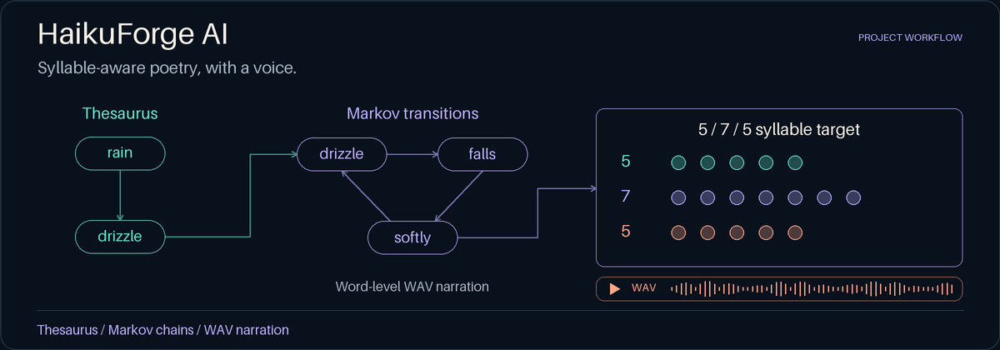
  </picture>
</a>

Created a Python CLI combining syllable-aware Markov generation, thesaurus-based text transformations, and word-level WAV narration. It explores how language can be generated and reshaped with explicit algorithms and a 5–7–5 target.

`Python` · `Markov chains` · `CLI` · `WAV audio`

**[Explore language generation →](https://github.com/fishman7337/sp-daaa-dsaa-ca1-haiku-generator)**

### 08 · Newspaper Restoration

<a href="https://github.com/fishman7337/sp-daaa-dsaa-ca2-newspaper-restoration">
  <picture>
    <source media="(max-width: 600px) and (prefers-reduced-motion: no-preference)" srcset="./assets/portfolio-restoration-mobile.gif" />
    <source media="(prefers-reduced-motion: no-preference)" srcset="./assets/portfolio-restoration.gif" />
    <source media="(max-width: 600px)" srcset="./assets/portfolio-restoration-mobile-static.png" />
    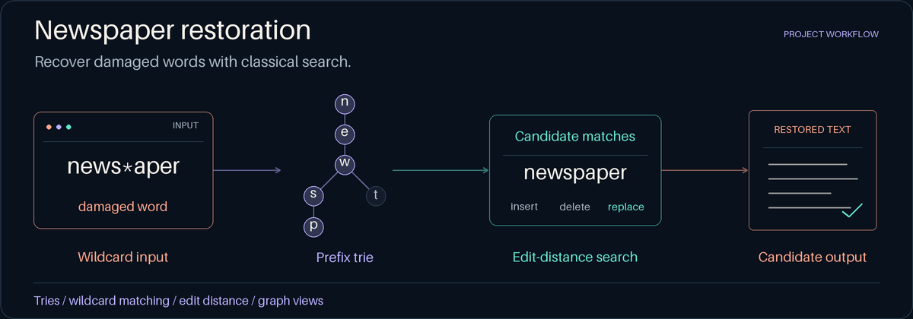
  </picture>
</a>

Built a text-recovery CLI using prefix tries, wildcard matching, and edit-distance search to suggest restorations for damaged newspaper text. Ranked candidates and graph views make the search process inspectable.

`Python` · `Prefix tries` · `NetworkX` · `Matplotlib`

**[Explore text restoration →](https://github.com/fishman7337/sp-daaa-dsaa-ca2-newspaper-restoration)**

### 09 · FitnessQuest

<a href="https://github.com/fishman7337/sp-daaa-bed-ca-fitnessquest">
  <picture>
    <source media="(max-width: 600px) and (prefers-reduced-motion: no-preference)" srcset="./assets/portfolio-fitness-mobile.gif" />
    <source media="(prefers-reduced-motion: no-preference)" srcset="./assets/portfolio-fitness.gif" />
    <source media="(max-width: 600px)" srcset="./assets/portfolio-fitness-mobile-static.png" />
    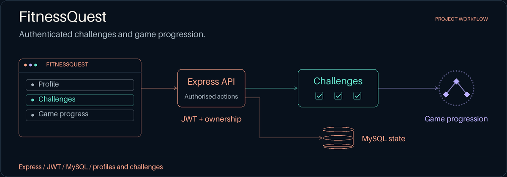
  </picture>
</a>

Developed a gamified fitness web application with authenticated Express APIs, user-scoped MySQL data, challenges, and game progression. Browser-flow tests cover key journeys through the application.

`JavaScript` · `Node.js / Express` · `MySQL` · `JWT` · `Playwright`

**[Explore the application →](https://github.com/fishman7337/sp-daaa-bed-ca-fitnessquest)**

### 10 · Pendulum Learning Lab

<a href="https://github.com/fishman7337/sp-daaa-dele-ca2-pendulum-reinforcement-learning">
  <picture>
    <source media="(max-width: 600px) and (prefers-reduced-motion: no-preference)" srcset="./assets/portfolio-pendulum-mobile.gif" />
    <source media="(prefers-reduced-motion: no-preference)" srcset="./assets/portfolio-pendulum.gif" />
    <source media="(max-width: 600px)" srcset="./assets/portfolio-pendulum-mobile-static.png" />
    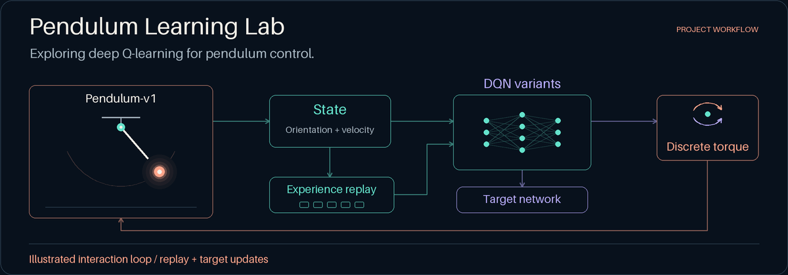
  </picture>
</a>

Developed a reinforcement-learning lab for comparing **Standard, Double, Dueling, and Rainbow-style DQN** on a simulated pendulum. Continuous torque is mapped into discrete actions, with reusable environment wrappers, replay buffers, training, and evaluation components. Seeded configurations and documented limitations make the experiments easier to inspect and reproduce.

`Python` · `TensorFlow / Keras` · `Gymnasium` · `NumPy` · `Reinforcement learning`

**[Explore the learning lab →](https://github.com/fishman7337/sp-daaa-dele-ca2-pendulum-reinforcement-learning)**

**[Browse all public repositories →](https://github.com/fishman7337?tab=repositories)**

## Experience

**Research Engineer · NCS · Pragnition Labs** 
*Internship · Oct 2026–present · Singapore*

Turn business and technical requirements into research questions, testable hypotheses, and AI prototypes. Evaluate performance, reliability, latency, cost, security, and maintainability; communicate findings and build reusable components.

**AI Research Intern · RSAF RAiD · AETHER** 
*Apr–Aug 2026*

Researched multimodal perception, geospatial data, neuromorphic vision, RF sensing, and language/vision-language reasoning. Built reproducible evaluations and documented methods, findings, and limitations for research handover.

**AI & Data Solutions Researcher · Singapore Polytechnic · Department of Communications** 
*Part-time · Mar 2026*

Built role-aware departmental workflows, a Supabase data architecture, decision-support tools, and AI assistance, supported by release, access-control, and usability checks.

**Co-Founder, Data & Intelligent Systems · Wagglo** 
*Feb–Mar 2026*

Designed compatibility scoring and recommendation workflows for a pet-owner matching concept, alongside privacy-conscious survey analysis to inform product priorities.

**Student Developer · Singapore Polytechnic · School of Computing** 
*Sep 2025–Mar 2026*

Developed an institutional Open House assistant using Amazon Bedrock, hybrid retrieval, reranking, persistent conversation state, and controlled user evaluation, with a FastAPI backend and Next.js interface.

**[Full journey on my website →](https://gohkunming.dev/#experience)** · **[LinkedIn experience →](https://www.linkedin.com/in/gohkunming/details/experience/)**

## Technical toolkit

### Models, research & data

| Area | Tools & methods |
| :--- | :--- |
| **Machine learning & forecasting** | scikit-learn · XGBoost · statsmodels · ensemble learning · ARIMA / SARIMAX · Optuna |
| **Deep learning & generative models** | PyTorch · TensorFlow / Keras · CNNs / ResNet · SimpleRNN / LSTM / GRU · GANs / VAEs |
| **Reinforcement learning** | Standard / Double / Dueling / Rainbow DQN · experience replay · target networks · seeded evaluation |
| **Vision & multimodal research** | OpenCV · Ultralytics YOLO · ONNX · multimodal perception · geospatial data · RF sensing |
| **Simulation** | Unreal Engine 5 · AirSim · RGB / thermal / LiDAR experiments · sensor-fusion comparisons |
| **Quantum & generative research** | Qiskit / Aer · latent-prior experiments · FID / KID evaluation · Jupyter |
| **Statistics & optimisation** | Gradient descent · PCA · hypothesis testing · ANOVA / Tukey HSD · bootstrap analysis · cross-validation |
| **Clustering & evaluation** | K-Means · agglomerative clustering · DBSCAN / OPTICS · error analysis · leakage checks · distribution drift |
| **Retrieval & language** | Amazon Bedrock · OpenAI / Cohere embeddings · pgvector · BM25 · reciprocal-rank fusion · query rewriting · reranking · hallucination grading |
| **Data engineering & analysis** | pandas · NumPy · PySpark · ETL · star-schema warehouses · data validation · geospatial enrichment |
| **Visualisation & dashboards** | Matplotlib · Seaborn · Plotly / Dash · Tableau · Power BI · NetworkX |
| **Algorithms & text processing** | Prefix tries · wildcard matching · edit-distance search · Markov chains · tokenisation |

### Applications, infrastructure & delivery

| Area | Tools & methods |
| :--- | :--- |
| **Languages** | Python · SQL · JavaScript · Rust · HTML / CSS |
| **Application engineering** | FastAPI · Flask · Node.js / Express · React / Next.js · REST APIs · Zod |
| **Databases** | PostgreSQL · MySQL · SQLite · Supabase |
| **Cloud & model serving** | AWS / EC2 · Linux / Ubuntu · Docker · TensorFlow Serving · model registries |
| **Access & data governance** | JWT · role-based access · row-level security · consent records · data-lifecycle design · audit logging |
| **Testing & delivery** | pytest · Playwright · Jest · Supertest · Ruff · Git · GitHub Actions · CI/CD · technical documentation |

### Coursework & continued learning

My professional certificate programmes and further coursework extend my toolkit in these areas:

| Area | Technologies & concepts studied |
| :--- | :--- |
| **AI agents & orchestration** | LangChain · LangGraph · CrewAI · AutoGen · BeeAI · tool calling · agent memory |
| **Retrieval & agent interfaces** | LlamaIndex · FAISS · ChromaDB · Gradio · Model Context Protocol (MCP) · FastMCP |
| **Transformers & LLM adaptation** | Hugging Face Transformers · PEFT · LoRA / QLoRA · quantisation · instruction tuning |
| **Alignment & foundations** | RLHF · PPO · DPO · reward modelling · linear algebra · multivariate calculus · AI infrastructure & operations |

**[Skills & experience on LinkedIn →](https://www.linkedin.com/in/gohkunming/)** · **[Explore my credential record →](https://www.linkedin.com/in/gohkunming/details/certifications/)**

## How I build

### Applied AI · From a need to a useful system

<picture>
  <source media="(max-width: 600px) and (prefers-reduced-motion: no-preference)" srcset="./assets/process-applied-mobile.gif" />
  <source media="(prefers-reduced-motion: no-preference)" srcset="./assets/process-applied.gif" />
  <source media="(max-width: 600px)" srcset="./assets/process-applied-mobile-static.png" />
  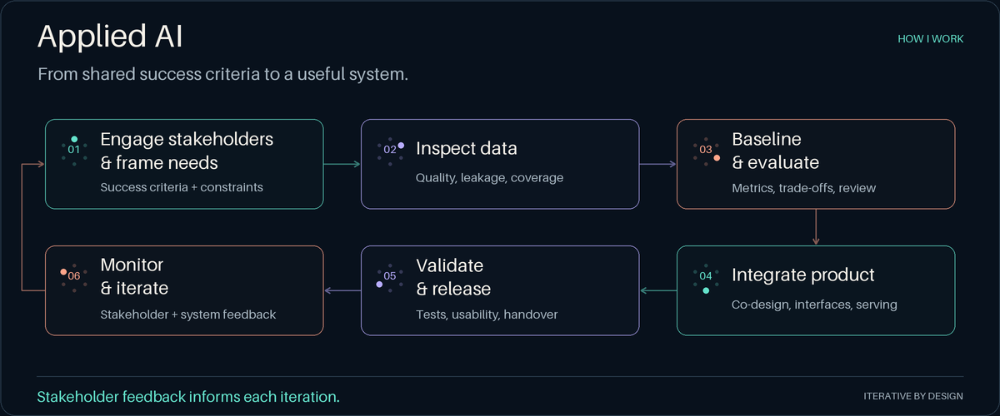
</picture>

**Stakeholder alignment → data → baseline & evaluation → product integration & feedback → validation & handover → monitoring & iteration.**

I start by engaging stakeholders to understand the users, decisions, success criteria, and practical constraints. I translate those needs into requirements, inspect data quality and leakage, and compare a baseline before connecting the model to an API and interface.

**Stakeholder engagement continues throughout the build:** review prototypes together, explain trade-offs, gather feedback, and agree on acceptance criteria. Before release, I check behaviour, usability, access controls, failure cases, latency, and cost. Clear documentation and handover support adoption; feedback and monitoring guide the next iteration.

### Research · From a question to defensible evidence

<picture>
  <source media="(max-width: 600px) and (prefers-reduced-motion: no-preference)" srcset="./assets/process-research-mobile.gif" />
  <source media="(prefers-reduced-motion: no-preference)" srcset="./assets/process-research.gif" />
  <source media="(max-width: 600px)" srcset="./assets/process-research-mobile-static.png" />
  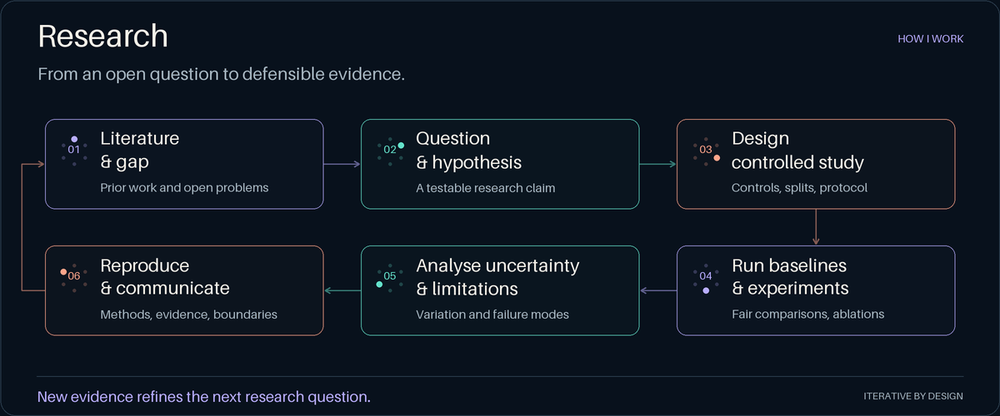
</picture>

**Literature & gap → question & hypothesis → study design → baselines & experiments → analysis & limitations → reproducibility & communication.**

I begin with what is already known and what remains uncertain. I define a testable question, choose comparison conditions and evaluation criteria, and keep data splits and experiment settings explicit. I use ablations and error analysis to examine the result, report uncertainty and negative findings, and document enough detail for others to inspect or reproduce the work. The findings may refine the hypothesis or motivate the next study.

## Beyond the projects

### Education

**Diploma in Applied AI & Analytics · Singapore Polytechnic** 
*2024–2027 · In progress, Year 3*

My studies span machine learning, data engineering, deep learning, cloud computing, and practical AI projects.

**Singapore-Cambridge GCE O-Level · Yuhua Secondary School** 
*2020–2023*

### Professional certificates

My professional certificates span AI engineering, agentic systems, deep learning, advanced analytics, and practical AI use.

| Professional certificate | Focus |
| :--- | :--- |
| **IBM AI Engineering Professional Certificate** | Machine learning, deep learning, and generative AI engineering |
| **IBM RAG and Agentic AI Professional Certificate** | Retrieval-augmented generation, tool use, MCP, and multi-agent workflows |
| **IBM Deep Learning with PyTorch, Keras and TensorFlow Professional Certificate** | Neural networks, transfer learning, model training, and evaluation |
| **Google Advanced Data Analytics Professional Certificate** | Statistical inference, regression, machine learning, and data storytelling |
| **Google AI Professional Certificate** | Responsible AI use for research, communication, data analysis, and application building |

**Additional specialisation:** *Mathematics for Machine Learning* — **Imperial College London**, issued October 2026; linear algebra, multivariate calculus, and PCA.

**[View credentials on LinkedIn →](https://www.linkedin.com/in/gohkunming/details/certifications/)**

My interests include **intelligent systems, AI safety and governance, quantum computing, and complexity science**. Education, practice, and service guide how I want to contribute: keep learning, test ideas carefully, and make knowledge useful to others.

### Outside work

Outside research and code, I enjoy gaming, music, discovering places to eat, coffee, time with family and friends, and travel. The Minecraft-inspired visuals are a nod to the server my polytechnic friends and I ran together in Year 2. I like building things that invite exploration.

## Let's connect

If your team is working on applied AI, research engineering, or data products, I'd be glad to discuss how my experience could contribute.

**[Email Kun Ming](mailto:kunmingaden@gmail.com)** · **[Connect on LinkedIn](https://www.linkedin.com/in/gohkunming/)** · **[Read my résumé](https://gohkunming.dev/documents/resume/goh-kun-ming-resume.pdf)** · **[Explore my website](https://gohkunming.dev/)**

Curious by default. Clear by design.
